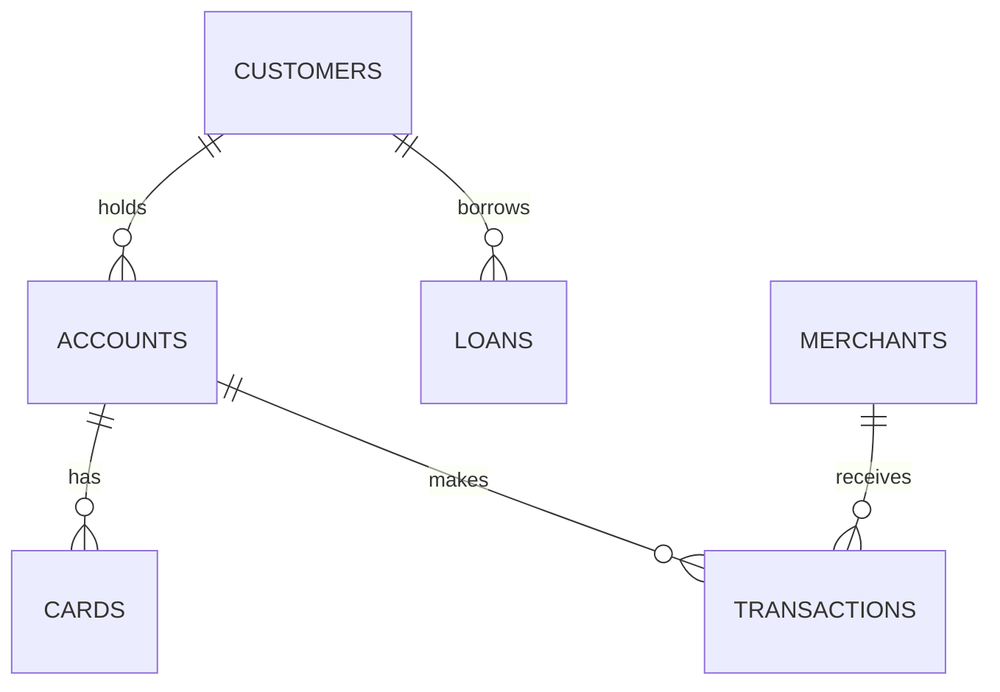

# PayFlow Analytics

A banking analytics project built on SQL Server and Power BI. It takes 1.26 million rows of synthetic banking data from raw CSV files to a four-page dashboard, with a data-quality gate in between that decides whether the data is fit to report on.

The data-quality layer is the core of the project. The first load matched only 11% of transactions to an account and none to a merchant. The cause was traced to a mixed file version, the correct file was reloaded, and the build now stops automatically if the same thing happens again.

## What this project covers

| Area | What is in the repo |
|---|---|
| Data modelling | Staging and analytics schemas, primary keys, foreign keys, indexes |
| Loading | Repeatable bulk load of 12 CSV files with row-count verification |
| Data quality | 29 automated checks across six rule types, scored and stored in a table |
| SQL analysis | 35 business queries using CTEs and window functions (`RANK`, `ROW_NUMBER`, `NTILE`, `LAG`, running totals, moving averages) |
| Reporting | Power BI model, DAX measures and a four-page dashboard with findings and actions on every page |

## Architecture

```text
CSV files  ->  staging schema  ->  data-quality checks  ->  analytics schema  ->  Power BI
(12 files)     (raw, no rules)     (29 checks, gate)        (keys enforced)       (DAX + 4 pages)
```

Data is loaded into `staging` exactly as it arrives, so that bad data can be measured rather than rejected silently. The analytics tables are only built when every Critical check passes.

## Data

Six related tables, all synthetic. The reporting period is 1 January 2019 to 31 December 2025.

| Table | Rows | One row is |
|---|---:|---|
| customers | 50,000 | a customer with a credit score |
| accounts | 75,000 | a deposit account (Checking, Savings or Business) |
| cards | 100,000 | a debit or credit card linked to an account |
| loans | 30,000 | a loan with an amount and interest rate |
| merchants | 5,000 | a merchant that receives payments |
| transactions | 1,000,000 | a payment from an account to a merchant |



Column-level detail is in [docs/data_dictionary.md](docs/data_dictionary.md).

## Headline numbers

As of the reporting date, 31 December 2025.

| Measure | Value |
|---|---:|
| Customers | 50,000 |
| Deposit accounts | 75,000 |
| Total account balance | $7.51B |
| Average account balance | $100,182 |
| Loans | 30,000 |
| Total loan exposure | $4.50B |
| Average interest rate | 8.51% |
| Cards | 100,000 |
| Expired cards | 12,665 (12.67%) |
| Transactions | 1,000,000 |
| Total transaction value | $5.00B |
| Average transaction | $5,000.82 |

## Data quality

The checks in [sql/03_data_quality_checks.sql](sql/03_data_quality_checks.sql) cover uniqueness, completeness, referential integrity, validity, identity and date logic. On the final data, 24 of 29 pass and 5 raise warnings. No Critical check fails.

| Check | Rows tested | Rows failed | Rate | Reading |
|---|---:|---:|---:|---|
| Email is used by only one customer | 50,000 | 7,600 | 15.20% | Email cannot identify a customer |
| Account opened on or after customer created | 75,000 | 37,408 | 49.88% | Dates are unrelated |
| Loan started on or after customer created | 30,000 | 15,069 | 50.23% | Dates are unrelated |
| Transaction dated on or after account opened | 1,000,000 | 501,669 | 50.17% | Dates are unrelated |
| Card expires on or after account opened | 100,000 | 923 | 0.92% | Genuine exceptions |

Two of these readings matter more than the counts:

- **Shared emails are not duplicate customers.** The 7,600 customers fall into 3,373 groups, and no group shares a name or a city. Merging them would combine different people, so the action is to stop using email as an identifier, not to deduplicate.
- **A 50% failure rate is not an exception list.** When half of all rows break a date rule, the two dates were generated independently. The conclusion is that tenure and lifecycle analysis cannot be done with these columns.

### The reconciliation that failed first

The first load of this project failed two Critical checks:

| Check | First load | After fix |
|---|---:|---:|
| Transactions matched to an account | 111,885 (11.19%) | 1,000,000 (100%) |
| Transactions matched to a merchant | 0 (0%) | 1,000,000 (100%) |

A diagnosis query separated "some bad rows" from "the wrong file". The transactions referenced 75,000 distinct account ids and 5,000 distinct merchant ids, the same counts as the master tables, yet only 8,393 account ids and no merchant ids overlapped. Matching counts with almost no overlap means a complete file from a different generation of the dataset, not damaged rows. Reloading the transactions extract that belongs with the master tables brought both checks to 100%.

The analytics tables now carry foreign keys, so the same mistake fails at load time. The full account is in [docs/data_quality_report.md](docs/data_quality_report.md).

## Findings

**Product holding**

- 11,162 customers (22.3%) have no deposit account, and 5,998 of them (12.0% of all customers) hold no product at all.
- 5,164 customers (10.3%) have a loan but no deposit account.
- 19,802 accounts (26.4%) have no card.
- 22,221 customers (44.4%) hold more than one account. The average across all customers is 1.5 accounts.

**Lending**

- Loan pricing does not reflect credit risk. The average interest rate is 8.51% for Low-credit customers and 8.52% for Excellent, and the correlation between credit score and interest rate is 0.004.
- 50.8% of customers are in the Low credit category (score under 580).
- Low-credit customers hold 5,068 Large loans (over $200K) worth $1.26B, which is 28.1% of the loan book.

**Cards**

- 12,665 cards (12.67%) had expired by the reporting date, and a further 12,545 expire during 2026.

**Deposits**

- The top 10% of account-holding customers hold 24.3% of balances. The top 10 customers hold between $0.84M and $1.02M each.

**Payments**

- Transaction volume is flat: every year has between 142,317 and 143,074 transactions, a spread of 0.5%.
- Transaction value is not concentrated. The top 10 of 5,000 merchants take 0.254% of value, against 0.200% if every merchant were the same size.
- Every account transacts. Accounts make between 1 and 33 transactions, most often 13, and 78% make between 9 and 17.
- Transaction value per customer rises in step with accounts held: $66,601 with one account, $133,422 with two, up to $541,375 with eight. Each account transacts at about the same rate, so value grows by roughly $67K per account.

## Recommended actions

Estimates use the stated assumption and the averages above.

| Action | Size | Assumption |
|---|---|---|
| Offer a first deposit account to the 11,162 customers without one | About $1.12B in new deposits | Each opens one account at the average balance of $100,182 |
| Review loan pricing for Low-credit customers | About $23M more interest a year | One percentage point more on the $2.29B Low-credit loan book |
| Plan card renewals | About 12,500 cards a year, 12,545 in 2026 | Expiries continue at the current rate |
| Offer a card on the 19,802 accounts without one | 19,802 accounts | None; this is a direct count |
| Cross-sell additional accounts | About $67K of transaction value per extra account | Customers keep transacting at the current rate per account |

## SQL queries

Every number on the dashboard and in this README comes from one of these queries.

**Data quality** ([sql/03_data_quality_checks.sql](sql/03_data_quality_checks.sql))

| Query | Question | Used in |
|---|---|---|
| Checks 101-106 | Is every primary key unique? | Scorecard |
| Checks 201-206 | Are any values missing? | Scorecard |
| Checks 301-305 | Does every row point at a real parent? | Scorecard, match-rate cards, reconciliation table |
| Checks 401-407 | Are scores, amounts, rates and types valid? | Scorecard |
| Check 501 | Is email unique per customer? | Shared emails card and chart |
| Checks 601-604 | Do events happen in a sensible order? | Date-order failure rate chart |
| D1 | Bad rows or the wrong file? | Reconciliation story |
| D2 | Are customers who share an email the same person? | Issues table |
| D3 | Which date rules are real exceptions? | Issues table |
| D4 | Which cards expire before their account opened? | Exception list |

**Business analysis** ([sql/05_business_analysis.sql](sql/05_business_analysis.sql))

| Query | Question | Used in |
|---|---|---|
| Q1 | What are the headline numbers? | Executive Overview cards |
| Q2 | What is the range and average credit score? | Data dictionary |
| Q3 | How are customers spread across credit categories? | Customer Credit Profile |
| Q4 | How many customers join each year? | Customer Acquisition Trend |
| Q5 | Is city a useful dimension? | Limitations |
| Q6 | How is balance split by account type? | Account Balance by Type |
| Q7 | How many accounts does each customer hold, including none? | Customers by Number of Accounts |
| Q8 | Who are the top 10 customers by balance? | Top 10 Customers by Account Balance |
| Q9 | Who are the top 3 customers in each account type? | Supporting analysis |
| Q10 | How concentrated are deposits? | Finding: top 10% hold 24.3% |
| Q11 | How many cards are expired, by type? | Card Status Distribution, Expired Cards |
| Q12 | How many cards expire each year? | Finding and action: renewals |
| Q13 | How many accounts have no card? | Finding and action: card offer |
| Q14 | What does the loan book look like? | Loan exposure card |
| Q15 | How are loans split by size? | Supporting analysis |
| Q16 | How much is lent each year? | Loan Exposure by Year |
| Q17 | Does the interest rate change with credit risk? | Loan pricing does not vary with credit risk |
| Q18 | How much is lent to Low-credit customers as Large loans? | Finding: 28.1% of the loan book |
| Q19 | What are the transaction totals? | Transactions page cards |
| Q20 | How do volume and value change by year? | Transaction Volume by Year, Transaction Value Trend |
| Q21 | What is the monthly value and its 3-month average? | Supporting analysis |
| Q22 | Which merchants take the most value? | Top 5 and Top 10 Merchants |
| Q23 | Is value concentrated in a few merchants? | Finding: 0.254% vs 0.200% |
| Q24 | How are transactions spread by amount? | Supporting analysis |
| Q25 | Which accounts transact the most? | Top 10 Accounts by Transaction Value |
| Q26 | Which products does each customer hold? | Findings and action: first account |
| Q27 | Who are the top 10 customers by spending? | Supporting analysis |
| Q28 | How do balance, borrowing and spending differ by credit category? | Supporting analysis |
| Q29 | Does spending rise with accounts held? | Transaction Value per Customer by Accounts Held |
| Q30 | How many customers hold more than the average balance? | Supporting analysis |
| Q31 | How many transactions does each account make? | Accounts by Number of Transactions |
| Q32 | What are the 10 largest single transactions? | Supporting analysis |
| Q33 | Which customers have both balances and loans above $100K? | Supporting analysis |
| Q34 | Which accounts hold the most cards? | Supporting analysis |
| Q35 | What share of spending does each top customer make up? | Supporting analysis |

## Limitations

- **The data is synthetic and close to uniformly random.** Balances, loan amounts and transaction amounts are evenly spread, so the flat trends and the absence of concentration are properties of the generator, not business results. The project demonstrates method, not banking insight.
- **Date columns are unrelated to each other**, as the data-quality checks show, so there is no tenure, vintage or lifecycle analysis.
- **City is too granular to analyse.** There are 25,169 distinct cities for 50,000 customers and the largest has 51 customers.
- **Balances are a single snapshot.** There is no balance history, so balances cannot be shown over time.
- **There is no shared date table.** The Year filter on the first two dashboard pages selects customers by the year they joined; the transactions page filters by transaction year.

## Dashboard

The Power BI report ([powerbi/PayFlow_Analytics.pbix](powerbi/PayFlow_Analytics.pbix)) has four pages. The first three each end with four findings and the action that follows from each; the fourth ends with a table of issues, impact and actions.

| Page | Shows |
|---|---|
| Executive Overview | Headline KPIs, customers acquired per year, transaction value by year, credit profile, balance by account type, loan exposure by year, top 5 merchants |
| Customer and Account Insights | Card status and type, accounts held per customer (including none), loan pricing by credit category, top 10 customers by balance |
| Transaction and Merchant Performance | Accounts by number of transactions, value per customer by accounts held, volume and average value by year, top 10 merchants and accounts |
| Data Quality and Business Risk | Match rates, the 29-check scorecard, the reconciliation before and after, date-order failure rates, shared emails, and the issue and action table |

The model, calculated columns and measures are documented in [powerbi/dax_measures.md](powerbi/dax_measures.md).

<!-- Add screenshots after refreshing the report, then remove this comment wrapper.


-->

## How to run

Requirements: SQL Server 2017 or later, SQL Server Management Studio, Power BI Desktop.

1. Copy the `data` folder to a path the SQL Server service can read, for example `C:\PayFlow\data\`.
2. Run the scripts in `sql/` in order:

| Script | What it does |
|---|---|
| `01_create_schema.sql` | Creates the database, schemas, tables, keys and indexes |
| `02_load_staging.sql` | Bulk-loads the CSV files. Set `@DataPath` at the top first |
| `03_data_quality_checks.sql` | Runs the 29 checks and writes `analytics.data_quality_results` |
| `04_build_analytics_layer.sql` | Publishes the analytics tables and the customer summary view. Stops if a Critical check failed |
| `05_business_analysis.sql` | The business queries |

3. Open `powerbi/PayFlow_Analytics.pbix` in Power BI Desktop. If your server is not `localhost`, change it under Transform data > Data source settings. Then click Refresh.

## Repository structure

```text
payflow-analytics/
├── README.md
├── data/
│   ├── customers.csv
│   ├── accounts.csv
│   ├── cards.csv
│   ├── loans.csv
│   ├── merchants.csv
│   └── transactions/            one file per year, 2019 to 2025
├── sql/
│   ├── 01_create_schema.sql
│   ├── 02_load_staging.sql
│   ├── 03_data_quality_checks.sql
│   ├── 04_build_analytics_layer.sql
│   └── 05_business_analysis.sql
├── powerbi/
│   ├── PayFlow_Analytics.pbix
│   └── dax_measures.md
└── docs/
    ├── data_dictionary.md
    ├── data_quality_report.md
    └── screenshots/             one image per dashboard page
```

## Data source

Synthetic banking dataset. No real customer, account or payment data is used.

Source: https://www.kaggle.com/datasets/akrambelha/synthetic-banking-dataset-csv-sql-sqlite
